# Verificación de Jacobi y Gauss-Seidel: Tarea 8

## Qué explica la diferencia con la presentación

Los algoritmos de actualización son correctos: Jacobi utiliza exclusivamente el
vector anterior y Gauss-Seidel usa inmediatamente cada componente nueva.
La diferencia principal está en la medida de error elegida.

| Fuente o ejemplo | Error para decidir la parada | Opción en la calculadora |
| --- | --- | --- |
| Tarea 8, apartado 3.2 | maxᵢ \|xᵢ⁽ᵏ⁾ − xᵢ⁽ᵏ⁻¹⁾\| | Norma infinito (Tarea 8) |
| Sesión 21, ejemplos 1 y 2 | √Σᵢ(xᵢ⁽ᵏ⁾ − xᵢ⁽ᵏ⁻¹⁾)² | Norma euclídea (presentación) |
| Sesión 21, ejemplo de Chapra, diapositivas 23 y 24 | maxᵢ 100·\|Δxᵢ\|/\|xᵢ⁽ᵏ⁾\| | Relativo porcentual máximo (Chapra) |

En las expresiones de la tabla, las barras verticales significan valor absoluto.
Para estos tres casos obligatorios se usa **el mismo criterio: norma infinito**,
con **ε = 0.0001** y **x⁽⁰⁾ = 0** en todas las componentes.
El residuo siempre es ‖Ax − b‖∞. El cambio entre iteraciones, el error frente a
una solución de referencia y el residuo son cantidades distintas. Alcanzar ε en
la primera cantidad no garantiza que el residuo sea menor que ε.

En el ejemplo 1 de la presentación, la primera aproximación de Jacobi es
(1.4, 0.5, 1.4): norma infinito = 1.4, norma euclídea = √4.17 = 2.042057786.
En Gauss-Seidel es (1.4, 1.2, 0.9): norma infinito = 1.4, norma euclídea =
√4.21 = 2.051828453. Ambos criterios absolutos llegan a ε = 0.0001 en
16 iteraciones para Jacobi y 5 para Gauss-Seidel en este ejemplo concreto.
Con otras tolerancias pueden terminar en iteraciones diferentes.

La diapositiva 6 contiene una errata en Jacobi, k = 11: **x₂ = 1.2461093684**,
en lugar de 1.246709. Otros valores de las tablas están truncados a diferentes
cantidades de decimales. El programa conserva toda la precisión durante el
cálculo y redondea únicamente al mostrar resultados. En k = 0 se muestra «—»
porque no existe una iteración previa con la que calcular un cambio.

El ejemplo 2 (cinco variables) también coincide. Tras tres pasos de Gauss-Seidel:

    x⁽³⁾ = (−1.980224, −1.0181376, −0.02184192, 0.992073216, 2.003214336)
    ‖Δx‖∞ = 0.124224
    ‖Δx‖₂ = 0.1699055855

En el ejemplo de Chapra, al elegir el criterio porcentual con ε = **0.05**
(es decir, **0.05 %**), ambos métodos paran en la iteración 4. No se debe
introducir una tolerancia porcentual como si fuera una tolerancia absoluta.
Cuando una componente se acerca a cero, una norma absoluta suele ser más útil.

## Cómo repetir las pruebas en la calculadora

Abrir el menú, entrar a **Métodos Numéricos**, elegir **Métodos iterativos:
Jacobi y Gauss-Seidel**, seleccionar **Comparar ambos**, y dejar el criterio
**Norma infinito (Tarea 8)**. Introducir los datos de cada caso y pulsar Calcular.
Los archivos PNG son capturas de los componentes reales de la interfaz Qt,
generadas en modo offscreen. Cada caso incluye entradas, resumen, las dos
tablas completas, sus CSV y una gráfica comparativa.

## Caso 1: Convergencia: ejemplo 1 de la sesión 21

```text
A = [10, 3, 1]
    [5, -10, 3]
    [1, 3, 10]
b = [14, -5, 14]
x⁽⁰⁾ = [0, 0, 0]
ε = 0.0001
Máximo de iteraciones = 100
Reordenamiento = activado
```

Comprueba la convergencia en una matriz estrictamente dominante: 10 > 3+1, 10 > 5+3 y 10 > 1+3. La solución de referencia es (125/134, 167/134, 125/134). Se utiliza el mismo sistema del ejemplo 1 de la presentación.

| Método | Iteraciones | Error ∞ final | Residuo ∞ | Diferencia ∞ con NumPy | Estado |
| --- | ---: | ---: | ---: | ---: | --- |
| Jacobi | 16 | 3.181207209e-05 | 0.0002544965767 | 1.733312009e-05 | Convergencia |
| Gauss-Seidel | 5 | 4.874625e-05 | 6.24819375e-05 | 5.478591418e-06 | Convergencia |

- Jacobi: x = (0.9328459666, 1.246251324, 0.9328459666).
- Gauss-Seidel: x = (0.9328310037, 1.246263178, 0.9328379462).

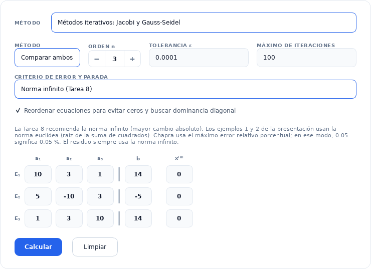

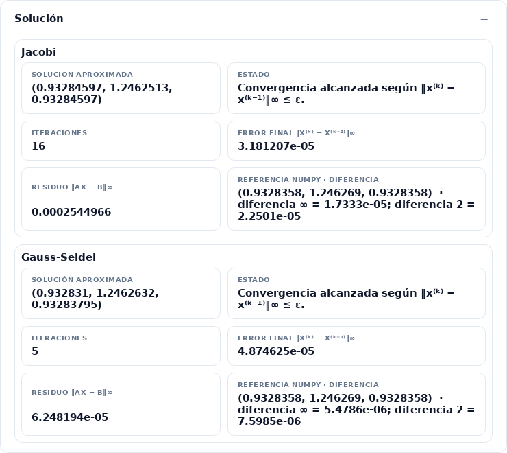

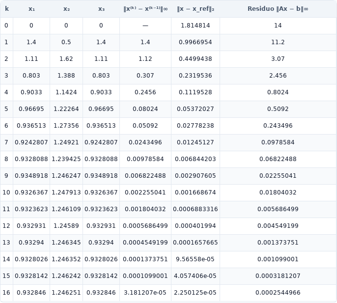

[Tabla completa de Jacobi en CSV](caso1_Jacobi.csv)

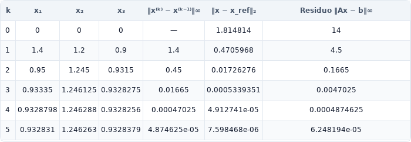

[Tabla completa de Gauss-Seidel en CSV](caso1_Gauss-Seidel.csv)

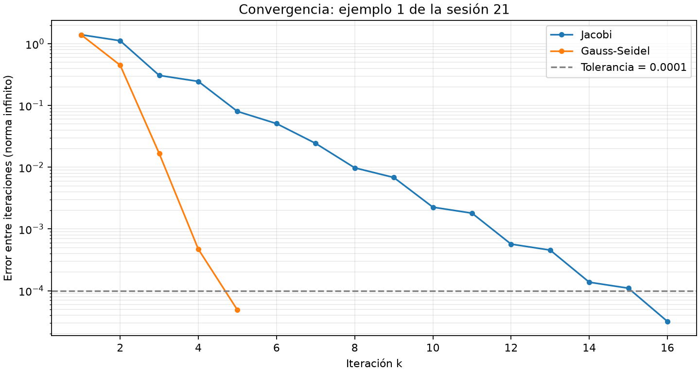

## Caso 2: Diagonal cero y reordenamiento válido

```text
A = [0, 5, 1]
    [4, 1, 1]
    [1, 1, 6]
b = [13, 9, 21]
x⁽⁰⁾ = [0, 0, 0]
ε = 0.0001
Máximo de iteraciones = 100
Reordenamiento = activado
```

Comprueba el tratamiento del cero a₁₁. El orden de ecuaciones encontrado es **[2, 1, 3]**. La nueva diagonal es (4, 5, 6), estrictamente dominante. El vector b pasa a (9, 13, 21); el orden de las variables y de x⁽⁰⁾ no cambia. La solución de referencia es **(1, 2, 3)**.

| Método | Iteraciones | Error ∞ final | Residuo ∞ | Diferencia ∞ con NumPy | Estado |
| --- | ---: | ---: | ---: | ---: | --- |
| Jacobi | 11 | 4.278763383e-05 | 6.372462746e-05 | 1.031620732e-05 | Convergencia |
| Gauss-Seidel | 6 | 7.708649812e-05 | 4.553805881e-05 | 1.150942202e-05 | Convergencia |

- Jacobi: x = (1.000010316, 2.000005082, 3.000008054).
- Gauss-Seidel: x = (1.000011509, 2.000001702, 2.999997798).


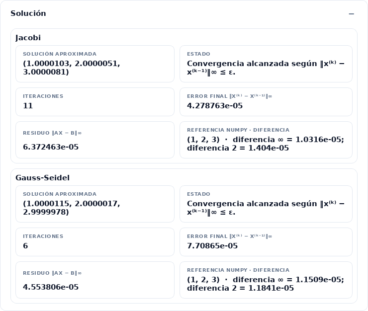

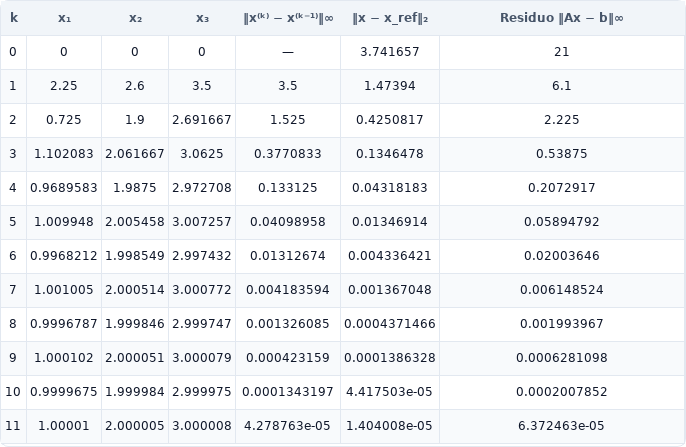

[Tabla completa de Jacobi en CSV](caso2_Jacobi.csv)

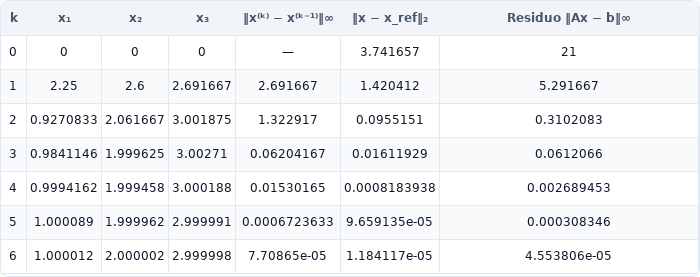

[Tabla completa de Gauss-Seidel en CSV](caso2_Gauss-Seidel.csv)

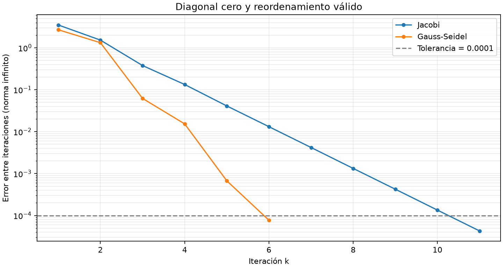

## Caso 3: Falta de convergencia en el orden original

```text
A = [1, 2]
    [2, 1]
b = [3, 3]
x⁽⁰⁾ = [0, 0]
ε = 0.0001
Máximo de iteraciones = 15
Reordenamiento = DESACTIVADO
```

Comprueba una falta de convergencia real: en el orden indicado, el error crece, con radio espectral 2 para Jacobi y 4 para Gauss-Seidel. Aunque la solución exacta es (1, 1), las iteraciones se alejan. El programa advierte del crecimiento y llega al máximo de 15 pasos. **Desactivar el reordenamiento es esencial:** si se activa, intercambia las dos filas, obtiene dominancia y ambos métodos convergen.

La ausencia de dominancia por sí sola no demuestra divergencia. Por ejemplo, A = [[1, 2], [0.1, 1]], b = [3, 1.1] converge con ambos métodos en su orden original, sin ser estrictamente dominante.

| Método | Iteraciones | Error ∞ final | Residuo ∞ | Diferencia ∞ con NumPy | Estado |
| --- | ---: | ---: | ---: | ---: | --- |
| Jacobi | 15 | 49152 | 98304 | 32768 | Máximo / no convergencia |
| Gauss-Seidel | 15 | 805306368 | 1610612736 | 1073741824 | Máximo / no convergencia |

- Jacobi: x = (32769, 32769).
- Gauss-Seidel: x = (536870913, -1073741823).

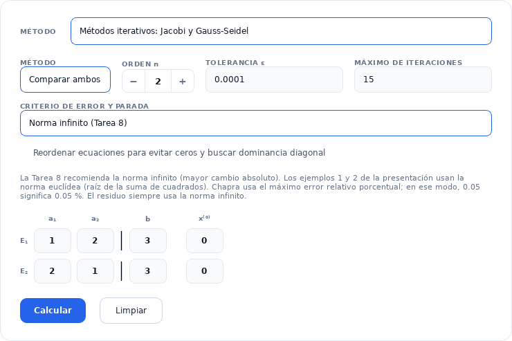

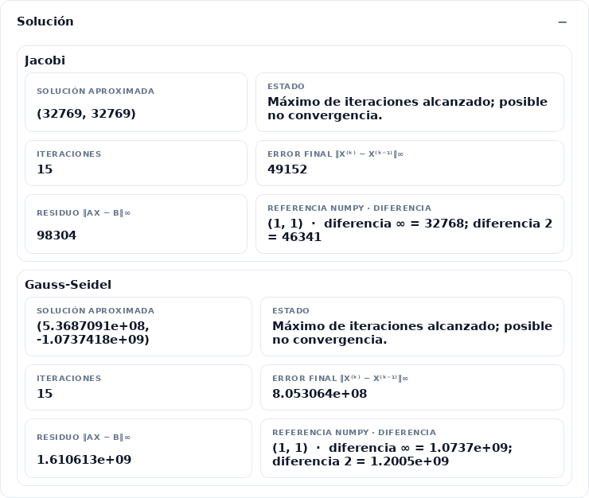

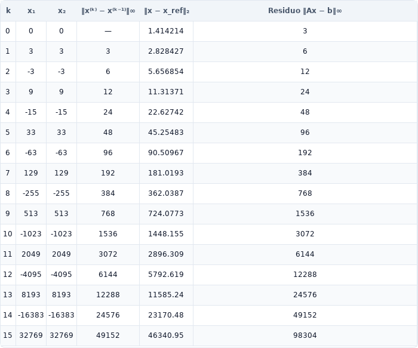

[Tabla completa de Jacobi en CSV](caso3_Jacobi.csv)

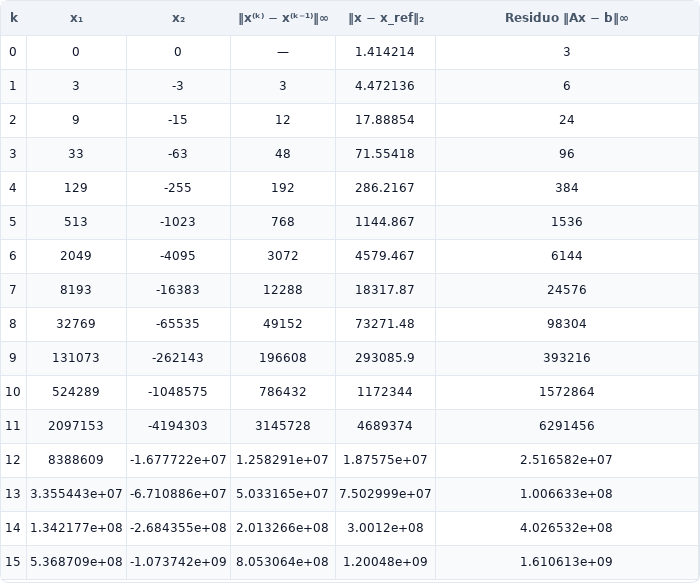

[Tabla completa de Gauss-Seidel en CSV](caso3_Gauss-Seidel.csv)

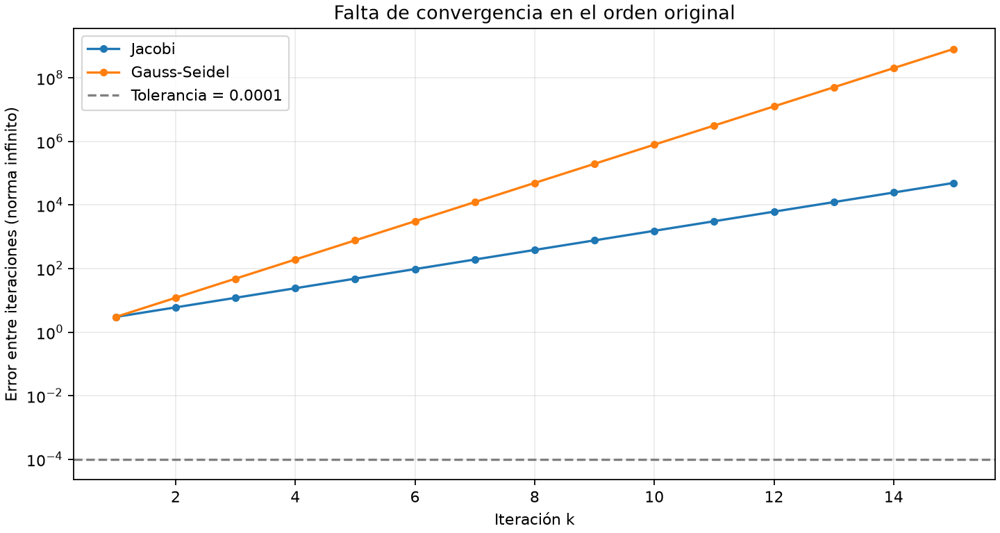

## Validaciones adicionales y correcciones

- Un cero en la diagonal con reordenamiento desactivado genera un mensaje de error.
- A = [[0, 1], [0, 2]] no admite diagonal no nula por permutación de filas y se rechaza.
- Se validan dimensiones, valores finitos, tolerancia positiva y máximo entero positivo.
- Se evita declarar un método más rápido cuando alguno no alcanza la tolerancia.
- Si no se encuentra un orden dominante y la diagonal original ya es válida, se
  conserva ese orden. Una permutación arbitraria puede destruir la convergencia.
- Cinco aumentos seguidos del error generan una advertencia. El proceso continúa
  hasta ε o el límite: el crecimiento transitorio no demuestra divergencia.
- Los valores no finitos detienen el proceso con un diagnóstico.
- NumPy se usa para validar las aproximaciones, después de ejecutar las
  iteraciones propias. No sustituye Jacobi ni Gauss-Seidel.

## Ejecución reproducible

Desde la raíz del proyecto en PowerShell:

```powershell
.\venv\Scripts\python.exe -m unittest discover -s tests -v
.\venv\Scripts\python.exe tests/generar_evidencias_tarea8.py
```

Las pruebas automáticas de `tests/test_iterativos.py` comprueban estos casos,
los tres ejemplos de la presentación, los criterios de parada y regresiones
de los ajustes realizados. El segundo comando regenera esta guía y las evidencias.

## Uso en el informe y la defensa

La Tarea 8 pide un informe PDF con portada oficial, objetivo, explicación de
algoritmos y validaciones, comparación y capturas legibles de los tres casos.
Esta guía aporta los datos y las evidencias numéricas para ese informe; no es
el PDF final de entrega. Añadir la portada y los datos reales del grupo.

En la defensa se puede explicar: «Jacobi calcula todas las componentes a partir
del vector anterior. Gauss-Seidel aprovecha las componentes nuevas de inmediato.
Usamos la norma infinito recomendada en la tarea y verificamos con el residuo y
NumPy. La presentación usa otra norma en algunos ejemplos. La dominancia estricta
garantiza convergencia, pero hay sistemas que convergen sin cumplirla».

Fuentes revisadas: `Tarea 8 (Elaboracion Programa 8_Python).pdf`, apartados 3 a 7;
`Sesion 21_Ejercicios acerca de Metodos iterativos_Jacobi y Gauss Seidel.pptx`,
diapositivas 3 a 9, 17 a 24. Los ejercicios de relajación de la diapositiva 25
no forman parte de los tres casos obligatorios del PDF de la Tarea 8.
